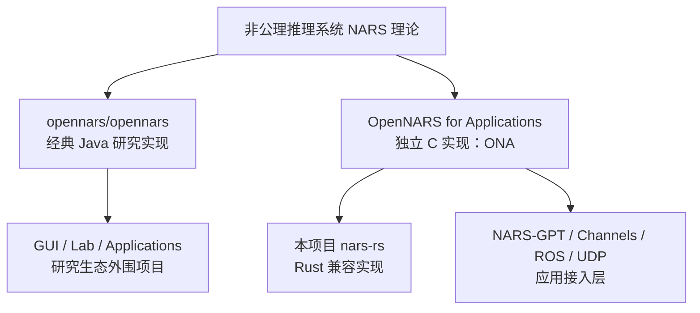
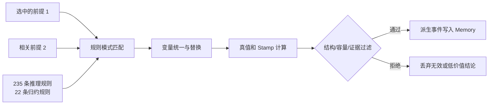
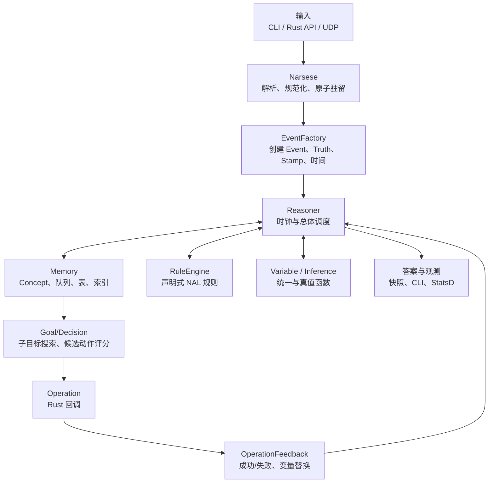
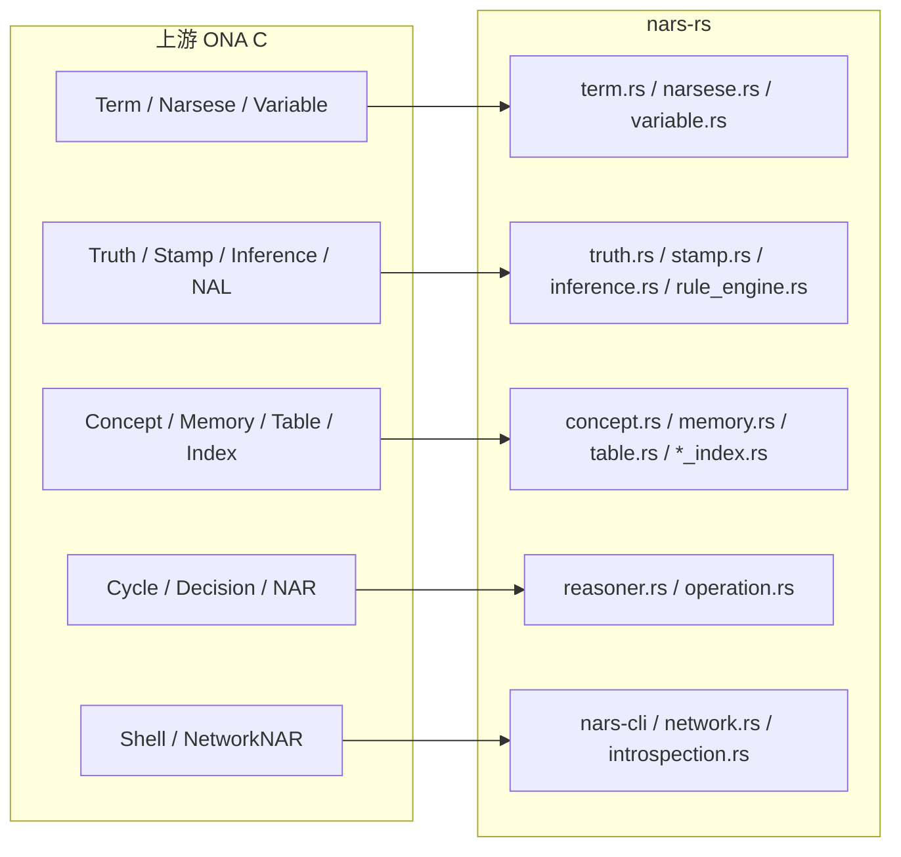
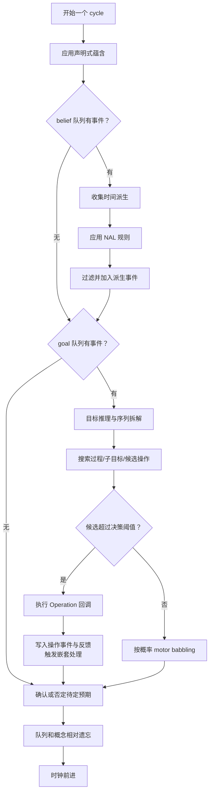
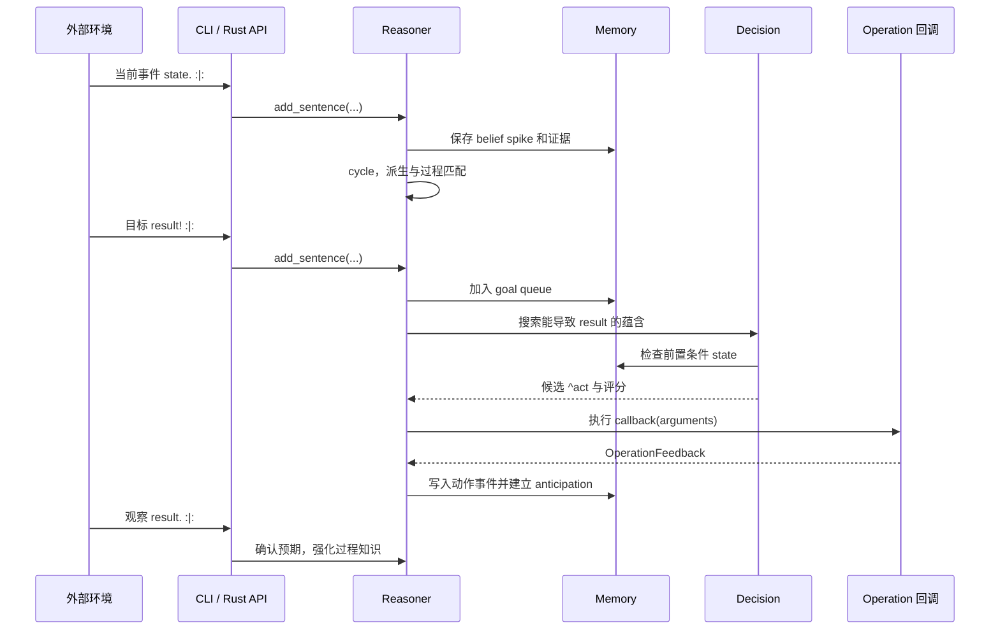
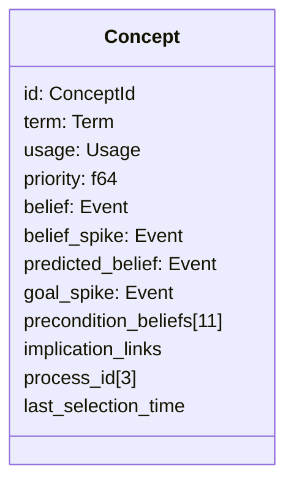
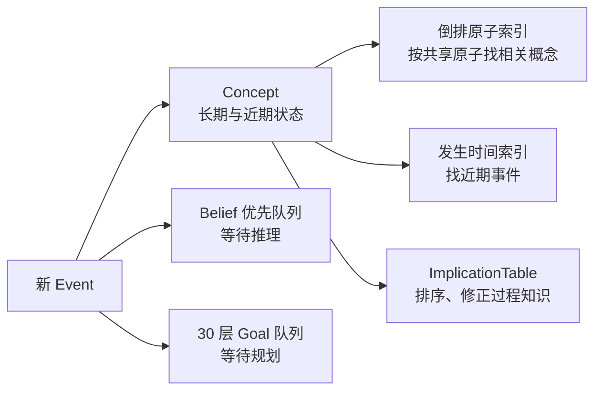
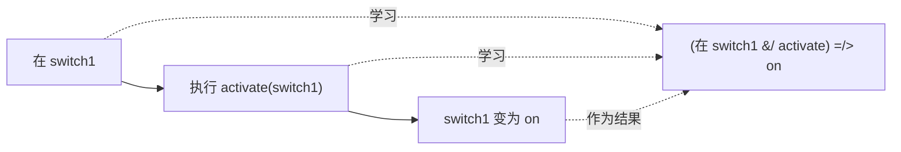
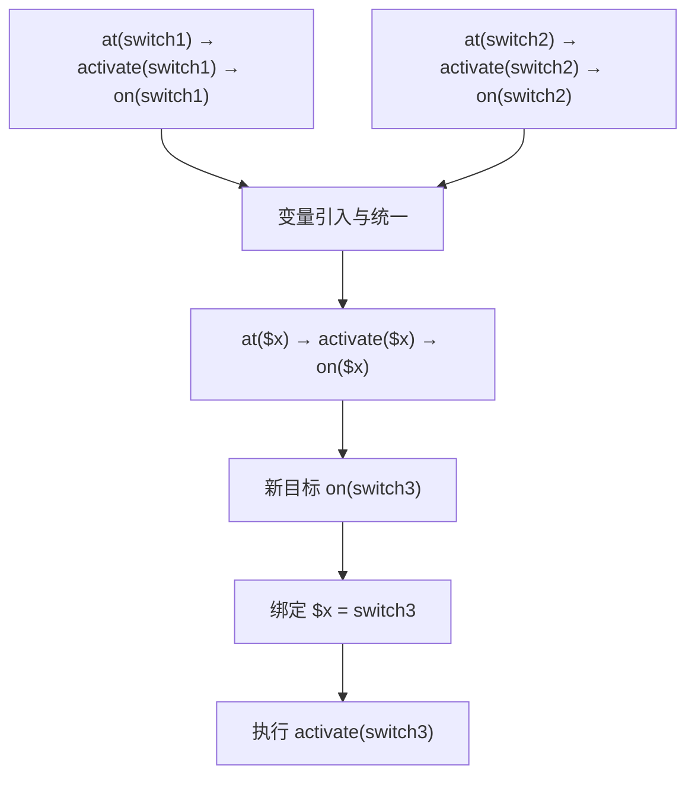

# nars-rs：OpenNARS for Applications 中文入门与实现指南

> 面向第一次接触 NARS、Narsese、ONA 和本项目的读者。
>
> 本文描述当前工作区的 Rust 实现，并以 OpenNARS for Applications（ONA）固定提交
> `dc4efd0a` 为兼容基线。阅读本文不要求读者预先掌握人工智能、形式逻辑或 Rust。

## 目录

1. [先用一分钟认识项目](#1-先用一分钟认识项目)
2. [OpenNARS 生态里哪个仓库是核心](#2-opennars-生态里哪个仓库是核心)
3. [NARS 到底是什么](#3-nars-到底是什么)
4. [本项目能做什么](#4-本项目能做什么)
5. [从零理解 Narsese](#5-从零理解-narsese)
6. [真值、不确定性与证据](#6-真值不确定性与证据)
7. [NARS 如何推理](#7-nars-如何推理)
8. [系统总体架构](#8-系统总体架构)
9. [一次推理循环发生了什么](#9-一次推理循环发生了什么)
10. [记忆系统如何组织知识](#10-记忆系统如何组织知识)
11. [Agent 如何学习并执行动作](#11-agent-如何学习并执行动作)
12. [项目代码导览](#12-项目代码导览)
13. [从零构建和运行](#13-从零构建和运行)
14. [在 Rust 程序中嵌入推理器](#14-在-rust-程序中嵌入推理器)
15. [CLI、UDP 与运行时观测](#15-cliudp-与运行时观测)
16. [兼容性、测试和性能](#16-兼容性测试和性能)
17. [如何二次开发](#17-如何二次开发)
18. [常见误区与 FAQ](#18-常见误区与-faq)
19. [术语表](#19-术语表)
20. [推荐学习路线与资料](#20-推荐学习路线与资料)

---

## 1. 先用一分钟认识项目

`nars-rs` 是 **OpenNARS for Applications（ONA）的 Rust 实现**。它不是聊天机器人，也不是
神经网络模型；它是一个可以嵌入程序、持续接收事件、在不完整知识下推理、形成目标、学习
过程并调用外部动作的实时推理内核。

可以把它先想象成一个小型 Agent 大脑：


最小例子：

```text
<cat --> animal>.
<animal --> living_thing>.
10
<cat --> living_thing>?
```

这四行的意思是：

1. `cat` 是 `animal`；
2. `animal` 是 `living_thing`；
3. 运行 10 个推理周期；
4. 询问 `cat` 是否是 `living_thing`。

本项目最重要的特点是：

- **资源有界**：概念、队列、证据戳和表都有固定容量，适合实时系统；
- **处理不确定性**：每条判断都可以带频率和置信度；
- **不仅做静态演绎**：还支持归纳、溯因、类比、修正和时间推理；
- **有目标和动作**：可以注册 Rust 回调，让推理结果真正影响外部世界；
- **在线学习过程**：从“状态 → 动作 → 结果”的事件流中学习可执行程序；
- **可审计**：上游 C 源码快照、规则和测试都保存在仓库中，可逐项对照。

---

## 2. OpenNARS 生态里哪个仓库是核心

OpenNARS 组织没有一个仓库在所有语境下都是唯一核心。要先区分“研究型 OpenNARS”和
“应用型 ONA”。

| 目标 | 应看的核心仓库 | 语言 | 定位 |
| --- | --- | --- | --- |
| 学习经典 OpenNARS 架构和研究体系 | [`opennars/opennars`](https://github.com/opennars/opennars) | Java | 经典研究型推理核心 |
| 构建实时 Agent、过程学习或嵌入式应用 | [`OpenNARS-for-Applications`](https://github.com/opennars/OpenNARS-for-Applications) | C | 应用型核心，简称 ONA |
| 阅读本工作区的实现 | 当前 `nars-rs` 工作区 | Rust | 以 ONA 为行为基线的安全 Rust 移植 |

关系可以概括为：



需要特别注意：

- ONA 官方明确说明它是一个**全新平台**，不是从经典 Java OpenNARS 分支出来的；
- ONA 组合了 OpenNARS 的逻辑与概念、ANSNA/20NAR1 的事件和过程学习，以及 ALANN 的控制模型；
- 名为 `opennars_core` 的仓库容易让人误以为它是当前唯一核心，但它属于较早的 Java 研究路线；
- 本工作区要兼容的是 ONA，而不是逐行翻译经典 Java 实现。

本项目固定使用上游 ONA 提交 `dc4efd0a`（2025-05-16）。固定版本意味着规则、测试结果和
行为差异都可以复现，不会因上游主分支变化而漂移。原始快照位于 `upstream/ona`。

更完整的组织仓库调查见根目录的 `OPENNARS_REPOSITORIES.md`。

---

## 3. NARS 到底是什么

NARS 是 **Non-Axiomatic Reasoning System**，中文通常译为“非公理推理系统”。

“非公理”并不是“没有规则”，而是说系统不假设自己拥有一套永远完整、永远正确、可以无限
计算的公理。它从一开始就接受三个现实条件：

1. 知识可能不完整；
2. 证据可能互相矛盾；
3. 时间和计算资源永远有限。

这套前提通常称为 **AIKR（Assumption of Insufficient Knowledge and Resources，知识与资源
不足假设）**。

### 3.1 一个直观例子

假设一个机器人只见过三只鸟：两只会飞，一只不会飞。它不应得出“所有鸟必定会飞”，也不应
因为存在反例就完全放弃“鸟通常会飞”。NARS 会保存一个带证据强度的判断，并在新证据到来时
修正它。

传统二值逻辑常把命题看成 `真/假`；NARS 更像是在说：

> 根据目前有限且可能重复的证据，这个判断出现得多频繁？证据量足以让我多自信？

### 3.2 和常见系统的区别

| 系统 | 主要能力 | 知识表达 | 学习/推理方式 | NARS 的差异 |
| --- | --- | --- | --- | --- |
| 传统规则引擎 | 按规则匹配和执行 | 通常是确定规则 | 前向/后向链 | NARS 的结论带证据，允许冲突和资源竞争 |
| 概率模型 | 估计随机变量分布 | 概率图或统计参数 | 概率推断/训练 | NARS 的真值不是简单等同于概率，置信度还表示证据支持程度 |
| 强化学习 | 从奖励学习策略 | 状态、动作、价值 | 试错优化 | ONA 能显式表示、查询并组合学到的过程知识 |
| 大语言模型 | 生成和理解序列 | 隐式分布式参数 | 预训练与上下文推断 | NARS 是显式符号推理器，体积小、可持续在线更新、结论可追踪 |
| 数据库 | 保存和查询事实 | 表、文档、图 | 精确查询 | NARS 会从有限注意力中选择内容并产生新判断和动作 |

NARS 与 LLM 并不必然互相替代。常见组合方式是：LLM 把自然语言转换为结构化 Narsese，NARS
负责持续记忆、受资源约束的推理与行动控制，再由 LLM 把结果表达成人类语言。

---

## 4. 本项目能做什么

当前实现覆盖了从语言解析到真实控制循环的大部分 ONA 核心能力。

### 4.1 声明式推理

- 继承、相似、蕴含、等价和复合项；
- 演绎、归纳、溯因、类比、修正等真值推理；
- 变量统一、查询变量和关系式查询；
- 235 条 ONA 声明式规则和 22 条归约规则；
- 高阶蕴含、关系 image、集合、交/差等结构。

### 4.2 时间与过程学习

- 区分永恒知识与当前事件；
- 从有序事件中形成时间序列；
- 学习“条件和动作导致结果”的时间蕴含；
- 对预期结果进行确认或负确认；
- 将在具体对象上学到的过程泛化到变量程序。

### 4.3 目标与 Agent 控制

- 接收目标并计算欲望强度；
- 递归寻找能达成目标的子目标和操作；
- 拆解序列目标，优先处理第一个尚未满足的分量；
- 通过 motor babbling 主动探索动作；
- 调用注册的 Rust 操作回调，并把执行反馈送回推理器。

### 4.4 工程能力

- 交互式 CLI；
- 原始 UDP 收发和持续循环的 `UdpNar`；
- StatsD/Graphite 计数器格式；
- 概念、队列、索引、操作配置和统计快照；
- 预解析输入接口，减少实时控制循环里的文本解析开销；
- Rust 全工作区禁止 `unsafe`。

---

## 5. 从零理解 Narsese

Narsese 是 NARS 使用的形式语言。它既描述知识，也描述事件、问题和目标。

### 5.1 Term：一切从“项”开始

Term（项）是系统能谈论的对象或结构。例如：

```text
cat
animal
{tom}
[yellow]
(cat * fish)
```

- `cat`、`animal`：普通原子项；
- `{tom}`：外延单例集合，可直观理解为具体个体 tom；
- `[yellow]`：内涵属性，可理解为“黄色这个性质”；
- `(cat * fish)`：乘积，把多个对象组成有顺序的关系参数。

### 5.2 Statement：项之间的关系

最常见的陈述结构是：

```text
<主项 --> 谓项>
```

例如：

```text
<cat --> animal>
<{tom} --> cat>
<{banana} --> [yellow]>
<({tom} * {room}) --> in>
```

可以分别读作：

- 猫是一种动物；
- tom 是猫；
- banana 具有黄色属性；
- tom 与 room 之间存在 `in` 关系，即 tom 在 room 中。

### 5.3 标点决定句子的用途

| 标点 | 类型 | 示例 | 含义 |
| --- | --- | --- | --- |
| `.` | belief，信念/判断 | `<cat --> animal>.` | 告诉系统一条知识 |
| `!` | goal，目标 | `<{door} --> [open]>!` | 希望这件事成立 |
| `?` | question，问题 | `<?what --> animal>?` | 查询匹配的知识 |

一个只有 Term 而没有句末标点的文本，不是完整的输入句子。

### 5.4 时态

| 标记 | 时态 | 直观含义 |
| --- | --- | --- |
| 无标记 | Eternal | 不绑定某个具体时刻的长期知识 |
| `:|:` | Present | 当前发生/当前成立 |
| `:\:` | Past | 过去 |
| `:/:` | Future | 将来 |

例如：

```text
<bird --> animal>.          // 永恒知识
<{ball} --> [left]>. :|:    // 当前观察：球在左边
```

当前 Rust 运行时的主要输入路径支持 Eternal 和 Present；解析器认识 Past/Future 标记，但作为
普通输入句提交时会拒绝尚不支持的过去/未来输入方式。

### 5.5 真值写法

项目支持 ONA 风格：

```text
<bird --> [fly]>. {0.8 0.7}
```

大括号里的两个数分别是：

- `frequency = 0.8`：正证据在全部证据中的比例；
- `confidence = 0.7`：目前证据量带来的确定程度。

省略时默认是 `{1.0 0.9}`。解析器也兼容旧格式 `%0.8;0.7%`。

### 5.6 常用关系和复合结构

| 写法 | 名称 | 例子 | 直观解释 |
| --- | --- | --- | --- |
| `-->` | inheritance | `<cat --> animal>` | cat 是 animal 的一种 |
| `<->` | similarity | `<cat <-> feline>` | 两者相似 |
| `==>` | implication | `<A ==> B>` | A 一般蕴含 B |
| `<=>` | equivalence | `<A <=> B>` | A 与 B 等价 |
| `=/>` | temporal implication | `<A =/> B>` | A 之后通常出现 B |
| `&&` | conjunction | `(A && B)` | A 且 B，不强调先后 |
| `&/` | sequence | `(A &/ B)` | A 之后 B，强调顺序 |
| `*` | product | `(a * b)` | 有序参数组合 |
| `--` | negation | `(-- A)` | A 的否定 |
| `{...}` | extensional set | `{tom}` | 具体个体/外延集合 |
| `[...]` | intensional set | `[red]` | 属性/内涵集合 |

### 5.7 变量

Narsese 有三类常用变量：

| 前缀 | 类型 | 用途 |
| --- | --- | --- |
| `$` | 独立变量 | 表示可在规则中独立替换的通用对象 |
| `#` | 依赖变量 | 同一个语境中需要一致绑定的对象 |
| `?` | 查询变量 | 在问题中寻找具体答案 |

例子：

```text
<<$1 --> bird> ==> <$1 --> animal>>.
<{robin} --> bird>.
20
<{robin} --> animal>?
```

查询“谁是动物”：

```text
<?who --> animal>?
```

### 5.8 Operation：可执行动作

操作名以 `^` 开头：

```text
^left
^pick
^activate
```

带参数的操作写成关系陈述：

```text
<({SELF} * {switch1}) --> ^activate>
```

其中 `{SELF}` 表示当前 Agent，自身之后的内容是传给操作回调的参数。上式可读作“自己执行
activate，参数是 switch1”。

一条可执行过程知识可能是：

```text
<(<{switch1} --> [at]> &/ <({SELF} * {switch1}) --> ^activate>) =/> <{switch1} --> [on]>>.
```

含义：当 Agent 位于 switch1 并执行 activate 后，switch1 通常会变为 on。

---

## 6. 真值、不确定性与证据

### 6.1 frequency 和 confidence 不是一回事

把真值记作 `(f, c)`：

- `f`（frequency）描述观察中命题成立的比例；
- `c`（confidence）描述证据量是否足以支持这个频率估计。

两个判断可能都有 `f = 1.0`，但可信程度完全不同：一次观察从未失败，和一万次观察从未失败，
频率一样，置信度却应不同。

代码中的 `Truth` 还可以转换为 evidential weight（证据权重），并计算 expectation（期望值）。
ONA 的决策会使用类似期望值的量来比较候选动作是否值得执行。

### 6.2 为什么需要 Stamp

每个事件带有 `Stamp`（证据戳），记录它来自哪些基础证据。它解决一个关键问题：

> 不能把同一份证据经过两条路径得到的结论，再当成两份独立证据相互加强。

例如 A 推出 B，B 又参与推出 C；如果之后拿 C 和同源结论合并，系统需要检查证据是否重叠。
本项目的证据戳容量固定为 10，并实现 zip、重叠检测、去重和修正规则。

### 6.3 Revision：冲突不是异常，而是输入

若系统先收到：

```text
<bird --> [fly]>. {0.9 0.6}
```

后来又收到：

```text
<bird --> [fly]>. {0.4 0.7}
```

只要证据来源允许组合，系统会通过 revision 形成一个新的综合判断，而不是简单覆盖旧值或抛出
冲突错误。

---

## 7. NARS 如何推理

以下用自然语言解释最重要的推理模式。实际真值会通过 `inference.rs` 中的公式计算，而不是照搬
经典逻辑的绝对真假。

### 7.1 Deduction：演绎

```text
鸟通常是动物。
robin 是鸟。
所以：robin 是动物。
```

```text
<bird --> animal>.
<{robin} --> bird>.
```

这是从一般知识和具体事实得到具体结论。

### 7.2 Induction：归纳

```text
观察到 robin 是鸟且会飞。
观察到 sparrow 是鸟且会飞。
形成：鸟通常会飞。
```

归纳结论不是逻辑必然，因此置信度会反映有限样本。

### 7.3 Abduction：溯因

```text
已知下雨往往导致地面湿。
现在看到地面湿。
猜测可能下过雨。
```

溯因是寻找可能解释，不保证原因唯一。

### 7.4 Analogy：类比

系统可以根据相似关系或共享属性，把一个对象上的知识以较弱真值迁移到另一个对象。

### 7.5 Revision：修正

把来源不同、指向同一判断的证据合并，得到更合适的频率和置信度。

### 7.6 Temporal inference：时间推理

ONA 不只保存静态“是什么”，还关心“先发生什么、后发生什么”。

```text
state. :|:
^act. :|:
result. :|:
```

重复观察这种事件顺序后，系统可以学习近似：

```text
<(state &/ ^act) =/> result>.
```

这条知识能反过来用于目标规划：若目标是 `result`，当前又有 `state`，就可以选择 `^act`。

### 7.7 规则引擎如何工作

本项目不是把 235 条规则手写成 235 个 Rust `if`。`RuleEngine::ona` 读取随 crate 打包的
`rules/ona-nal.h`，解释 ONA 的声明式规则表，并执行匹配、替换、归约、真值函数和结构过滤。



过滤不是无关紧要的优化。它保证嵌套高阶陈述、变量出现、集合操作、时序连接和包含操作的条件
符合 ONA 的结构约束，也避免无界派生淹没有限内存。

---

## 8. 系统总体架构



`Reasoner` 是使用者最常接触的门面对象。它拥有：

- `language: Narsese`：语言字典、解析和格式化；
- `memory: Memory`：概念和事件存储；
- `rules: RuleEngine`：规则表；
- 内部事件工厂、操作表、待确认预期、随机状态和当前时间。

它不是一个异步黑盒。调用 `add_sentence` 时会触发 ONA 风格的输入处理和 cycle；调用
`cycles(n)` 可以显式推进多个周期；`UdpNar` 则在独立线程中持续推进。

### 8.1 上游 C 到 Rust 的模块映射



Rust 实现追求行为兼容，而不是机械复制 C 的指针池。低层固定容量栈和链式哈希表使用安全 Rust
实现，公共运行时禁止 `unsafe`。

---

## 9. 一次推理循环发生了什么

`Reasoner::cycle` 是系统心跳。简化后的主路径如下：



这里有几个容易忽略的设计点：

1. **一次只选择有限内容**：不是穷举所有知识组合；
2. **优先级会衰减**：长期不用的事件和概念逐渐失去竞争力；
3. **输入会触发循环**：加入当前事件不仅是“存数据库”，还会学习事件关系；
4. **动作反馈会再次进入系统**：执行与推理形成闭环；
5. **目标分层有界**：最多 30 层，避免递归规划无限扩张。

### 9.1 从输入到动作的时序



---

## 10. 记忆系统如何组织知识

### 10.1 Concept 是记忆的基本单元

Memory 不只是一个 `Term -> Truth` 字典。每个被概念化的 Term 对应一个 `Concept`：



字段的直观意义：

- `belief`：较稳定、可长期查询的信念；
- `belief_spike`：近期突然出现的当前事件；
- `predicted_belief`：由过程知识预测的当前事件；
- `goal_spike`：当前活跃目标；
- `precondition_beliefs`：以这个概念为结果的过程知识，按操作槽分表保存；
- `implication_links`：与声明式蕴含相关的链接；
- `usage` 与 `priority`：决定有限资源下谁更值得保留和处理。

### 10.2 为什么同时需要队列、表和索引



- **优先队列**解决“下一步算什么”；
- **概念存储**解决“关于这个 Term 已知什么”；
- **倒排索引**解决“哪些概念和当前 Term 共享原子”；
- **时间索引**解决“最近发生过什么”；
- **蕴含表**解决“哪些条件/动作可能导致该结果”。

### 10.3 固定容量不是缺陷，而是理论的一部分

关键默认上限来自 `config.rs`：

| 资源 | 默认上限 |
| --- | ---: |
| Concept 数 | 4096 |
| 单个复合 Term 编码槽 | 64 |
| 原子数 | 255 |
| Stamp 证据项 | 10 |
| 蕴含表 | 120 |
| occurrence time index | 512 |
| cycling belief queue | 40 |
| 每层 goal queue | 400 |
| goal 层数 | 30 |
| 注册操作数 | 10 |
| 单操作探索参数数 | 10 |
| 每次相关概念匹配目标 | 80 |

内存满时，系统依据使用情况和 usefulness 回收低价值概念，而不是持续增长。固定容量让最坏情况
更可预测，也迫使控制机制把计算放在当前最相关的知识上。

这会带来真实取舍：特别大的示例可能被拒绝。`map2.nal` 在 Rust 和固定上游 ONA 中都因为容量
限制而拒绝，因此它是兼容行为，不是 Rust 移植独有的回归。

---

## 11. Agent 如何学习并执行动作

### 11.1 从演示学习过程

假设环境依次提供：

```text
<{switch1} --> [at]>. :|:
<({SELF} * {switch1}) --> ^activate>. :|:
<{switch1} --> [on]>. :|:
```

系统从事件的时间邻近关系中形成过程知识：



以后收到目标：

```text
<{switch1} --> [on]>! :|:
```

推理器就能从结果反查过程，检查当前位置条件，并选择 `^activate`。

### 11.2 Motor babbling：先探索，后利用

Agent 一开始可能没有任何过程知识。motor babbling 会按配置概率随机尝试已注册操作，观察结果，
再学习哪些动作在什么状态下有用。这类似婴儿通过挥动手脚理解动作后果，也类似强化学习中的
探索，但学到的是显式时间蕴含。

默认探索概率为 `0.2`，可通过 API 或 Shell 命令调整。随机数生成器可设置种子，因此测试和
实验可重复。

### 11.3 Anticipation：预期与负确认

执行一条已知过程中的动作后，Reasoner 会登记一个待确认预期：

```text
如果 precondition 和 action 成立，expected result 应在截止时间前出现。
```

- 结果按时出现：确认预期，支持该过程；
- 结果没有出现：生成低置信度负确认，削弱或修正该过程。

这让系统不只记住成功，也能从失败中更新。当前实现按 ONA 风格，在相关 spike 仍活跃时立即
应用负确认。

### 11.4 变量过程迁移

若系统分别在 `switch1`、`switch2` 上见到相同模式，它可以引入变量，把具体过程泛化：



这不是把字符串 `switch1` 替换成 `switch3`。它依赖变量统一、操作参数绑定、过程表选择和当前
条件检查。主动问题还能把变量目标落地成具体操作参数。

### 11.5 多步目标

如果目标需要多个阶段，Reasoner 会递归寻找子目标。例如：

```text
目标：door_open
过程 1：at_switch &/ ^activate =/> light_on
过程 2：light_on &/ ^open =/> door_open
```

系统可先把 `light_on` 作为子目标，再寻找让 `light_on` 成立的动作。搜索是有界的，并结合
30 层 goal queue、当前上下文、过程可信度、具体性和决策阈值控制成本。

---

## 12. 项目代码导览

```text
nars/
├── Cargo.toml                  # Rust workspace：nars-core + nars-cli
├── README.md                   # 项目状态和快速命令
├── UPSTREAM.md                 # 上游固定版本与兼容策略
├── COMPATIBILITY.md            # 单元/系统测试兼容矩阵
├── PERFORMANCE.md              # 性能与长循环基线
├── OPENNARS_REPOSITORIES.md    # OpenNARS 组织仓库调查
├── crates/
│   ├── nars-core/
│   │   ├── rules/ona-nal.h     # ONA 声明式规则表
│   │   ├── examples/throughput.rs
│   │   └── src/                # 核心实现
│   └── nars-cli/
│       └── src/main.rs         # shell 和 UDPNAR 命令
├── scripts/
│   └── evaluate_nal_examples.py
└── upstream/ona/               # 固定的上游 ONA C 快照、测试和示例
```

### 12.1 `nars-core/src` 模块职责

| 文件 | 作用 | 建议何时读 |
| --- | --- | --- |
| `lib.rs` | 模块声明和公共导出 | 第一站 |
| `config.rs` | ONA 固定容量与默认阈值 | 理解实时约束时 |
| `term.rs` | 64 槽固定大小 Term 编码 | 理解底层表示时 |
| `narsese.rs` | 解析、规范化、格式化、操作识别 | 学语法后第一读 |
| `truth.rs` | Truth、weight、expectation | 学真值系统时 |
| `stamp.rs` | 证据来源与重叠检测 | 学 revision 时 |
| `inference.rs` | 推理真值函数 | 研究数学细节时 |
| `variable.rs` | 统一、替换、变量引入 | 学规则和程序泛化时 |
| `rule_engine.rs` | 加载和执行 235/22 规则 | 学声明式推理时 |
| `event.rs` | Event、EventFactory、时态信息 | 学输入生命周期时 |
| `concept.rs` | 单个 Concept 的布局 | 学 Memory 前 |
| `memory.rs` | 概念化、存储、队列、回收、索引 | 核心必读 |
| `table.rs` | 蕴含排序和修正 | 学过程存储时 |
| `priority_queue.rs` | 有界优先队列 | 学控制机制时 |
| `occurrence_time_index.rs` | 按发生时间定位事件 | 学时间推理时 |
| `inverted_atom_index.rs` | 按共享原子找相关概念 | 学检索优化时 |
| `reasoner.rs` | cycle、目标、过程学习、决策、动作 | 最重要也最长，最后系统读 |
| `operation.rs` | 动作回调和反馈 | 嵌入 Agent 时 |
| `network.rs` | UDP、UdpNar、Shell 输入处理、指标 | 做集成时 |
| `introspection.rs` | 统计和结构化快照 | 做可观测性时 |
| `bounded.rs` | 安全固定容量栈/哈希表 | 对照 C 低层测试时 |

### 12.2 推荐源码阅读顺序

不要第一天就从头硬啃几千行 `reasoner.rs`。更顺畅的顺序是：

1. `lib.rs`、`config.rs`；
2. `truth.rs`、`stamp.rs`、`event.rs`；
3. `term.rs`、`narsese.rs`；
4. `concept.rs`、`priority_queue.rs`、`table.rs`；
5. `memory.rs`；
6. `inference.rs`、`variable.rs`、`rule_engine.rs`；
7. `operation.rs`、`reasoner.rs`；
8. `network.rs` 和 `nars-cli`；
9. 最后对照 `upstream/ona/src` 与系统测试。

---

## 13. 从零构建和运行

### 13.1 环境要求

- Rust 1.85 或更高；
- Cargo；
- macOS、Linux 或其他能运行 Rust 的常规环境。

查看版本：

```bash
rustc --version
cargo --version
```

### 13.2 构建

在项目根目录运行：

```bash
cargo build --workspace
```

发布模式：

```bash
cargo build --workspace --release
```

### 13.3 运行全部测试

```bash
cargo test --workspace
```

只测核心：

```bash
cargo test -p nars-core
```

### 13.4 启动交互式 Shell

```bash
cargo run -p nars-cli
```

然后输入：

```text
<cat --> animal>.
<animal --> living_thing>.
10
<cat --> living_thing>?
quit
```

Shell 中单独一行整数表示额外运行多少个推理步骤；`quit` 退出。

### 13.5 第一个不确定性实验

```text
<bird --> [fly]>. {0.9 0.6}
<bird --> [fly]>. {0.4 0.7}
10
<bird --> [fly]>?
```

观察修正后的频率和置信度。不要期待简单平均：Revision 会先把 confidence 转换为证据权重。

### 13.6 第一个目标与动作实验

CLI 默认注册了 `^left`、`^right`、`^up`、`^down`、`^say`、`^pick`、`^drop`、`^go`、
`^activate`、`^deactivate` 十个操作。可输入：

```text
*motorbabbling=false
*setopname 1 ^act
<(state &/ ^act) =/> result>.
state. :|:
result! :|:
```

推理器找到过程后，Shell 会打印类似：

```text
^act executed with args
```

### 13.7 运行吞吐示例

```bash
cargo run --release -p nars-core --example throughput -- 1000000 10000
```

参数含义和当前基线请以 `PERFORMANCE.md` 为准。性能数字受 CPU、编译器和系统负载影响，不要只
用一次运行结果做结论。

---

## 14. 在 Rust 程序中嵌入推理器

以下代码展示最小集成方式：创建推理器、注册操作、加入知识和目标。

```rust
use nars_core::{OperationFeedback, Reasoner};

fn main() -> Result<(), Box<dyn std::error::Error>> {
    let mut nar = Reasoner::new()?;

    nar.add_operation("^open", |arguments| {
        println!("执行 open，参数 Term = {arguments:?}");

        // 真实项目可以在这里控制机械臂、调用设备 API 或发送消息。
        OperationFeedback::default()
    })?;

    nar.add_sentence(
        "<(<{door} --> [closed]> &/ <({SELF} * {door}) --> ^open>) =/> <{door} --> [open]>>."
    )?;
    nar.add_sentence("<{door} --> [closed]>. :|:")?;
    nar.add_sentence("<{door} --> [open]>! :|:")?;

    nar.cycles(20);
    Ok(())
}
```

操作回调接收一个 `Term`：

- 原子操作 `^left` 通常收到空 Term；
- `<({SELF} * {door}) --> ^open>` 的回调参数是 `({SELF} * {door})`；
- 回调必须满足 `Send + Sync + 'static`，因此可安全放入持续运行服务；
- 返回的 `OperationFeedback` 可以表示失败，也可以携带变量替换结果。

### 14.1 高频实时输入建议预解析

传感器循环中若每帧重复解析同一模板，可先通过该 Reasoner 的 `language.parse_sentence` 得到
`Sentence`，以后调用 `add_parsed_sentence`。注意：Term 使用每个 `Narsese` 实例自己的原子
字典，因此不能把一个 Reasoner 解析出的 Sentence 直接交给另一个 Reasoner。

### 14.2 API 选择

| 需求 | 推荐接口 |
| --- | --- |
| 输入完整 Narsese 句子 | `Reasoner::add_sentence` |
| 输入已解析句子 | `Reasoner::add_parsed_sentence` |
| 直接添加信念 | `add_belief` |
| 直接添加目标 | `add_goal` |
| 提问 | `ask` |
| 推进一个周期 | `cycle` |
| 推进多个周期 | `cycles` |
| 注册外部动作 | `add_operation` |
| 配置探索参数 | `set_operation_arguments` |
| 读取运行统计 | `stats_snapshot` |

---

## 15. CLI、UDP 与运行时观测

### 15.1 Shell 输入类型

`process_input` 能处理：

- 空行和注释；
- 整数 cycle 数；
- `*reset`；
- belief、goal、question；
- 阈值、motor babbling、证据戳、数值空间、概念限制和操作槽配置；
- 统计、概念、队列、索引和操作配置检查命令。

几个常用命令：

```text
*stats
*concepts
*opconfig
*reset
```

完整支持集合应以 `network.rs` 中 `process_input` 的命令分支和测试为准，因为上游 ONA 的高级
Shell 命令仍有一部分在移植中。

### 15.2 启动 UDPNAR

```bash
cargo run -p nars-cli -- UDPNAR 127.0.0.1 50000 10000000
```

参数依次为：

1. 监听 IP；
2. 端口；
3. 每个 cycle 的时间步长，单位纳秒。

`UdpNar` 内部拥有共享 Reasoner，并分别运行接收和循环线程。它支持可确定的停止、线程 join，
并兼容 ONA 使用的 NUL 结尾 Narsese UDP 数据报。

### 15.3 StatsD

网络模块支持 Graphite/StatsD counter 格式：

```text
<path>:<value>|c
```

它适合把 cycle、输入、动作或环境指标送到外部监控系统。推理器自身还提供结构化快照，适合在
应用里构建调试面板，而不必解析 Shell 文本输出。

---

## 16. 兼容性、测试和性能

### 16.1 当前验证结果

在当前固定基线上：

- 上游 NAL 示例：**138/138 个标注期望通过**，覆盖 57 个 `.nal` 文件；
- `map2.nal`：与固定上游一致，因为固定容量而拒绝；
- release 核心测试：**105/105**；
- workspace 测试：**109/109**，其中 core 105、CLI 4；
- `clippy` 和格式检查通过；
- Cartpole、Alien、Pong、Pong2、Robot、Testchamber、UDPNAR 等系统场景通过。

### 16.2 系统测试为什么重要

普通单元测试只能说明某个公式或容器正确。Agent 还需要证明完整闭环成立：


因此项目保留了上游风格的长循环环境：

- **Cartpole**：连续动力学、角度离散、左右控制；
- **Alien**：左右移动、射击和命中反馈；
- **Pong/Pong2**：球拍跟随、回合重置、三动作版本；
- **Robot**：41×21 房间、八方向、扇区视觉、墙门与食物；
- **Testchamber**：位置、开关、灯、门和多步目标；
- **UDPNAR**：网络输入、独立循环和动作执行。

### 16.3 如何理解“兼容”

兼容不等于源代码逐行相同，而是：

- 真值、规则、容量和关键控制语义对齐；
- 固定输入下得到与上游一致的可观察行为；
- 上游单元和系统断言有对应 Rust 测试；
- 有意的安全实现差异被记录；
- 尚未完成的 Shell 或深层控制功能明确标为进行中。

详细矩阵见 `COMPATIBILITY.md`；性能环境和可复现实验见 `PERFORMANCE.md`；上游审计原则见
`UPSTREAM.md`。

---

## 17. 如何二次开发

### 17.1 做一个新的 Agent

建议按以下顺序：

1. 定义少量稳定的感知谓词，例如位置、颜色、接触状态；
2. 为每个外部动作注册一个 `^operation`；
3. 决定动作是否需要有限参数集合；
4. 把每一帧环境状态作为 Present belief 输入；
5. 把成功/失败或奖励状态显式表示为事件；
6. 在需要时输入 goal；
7. 固定随机种子，先用确定性测试验证；
8. 检查概念、队列和操作快照，再调阈值。

不要一开始把环境所有字段都转换成 Narsese。资源有界系统更需要有意义的感知抽象。

### 17.2 添加新语法或 Term 结构

需要同时考虑：

- `narsese.rs` 的 canonicalize、tokenize、parse 与 format；
- 固定 64 槽 Term 能否表示；
- 变量规范化和结构合法性；
- RuleEngine 是否认识相关 copula；
- 与上游示例和 round-trip 测试是否一致。

### 17.3 修改推理规则

优先检查 `crates/nars-core/rules/ona-nal.h` 和 `rule_engine.rs`。规则变化风险很高，因为一条规则
可能影响大量 `.nal` 示例。至少应运行：

```bash
cargo test --workspace
python3 scripts/evaluate_nal_examples.py
```

并对照固定上游输出，区分“理论上更合理”与“当前兼容基线”的差别。

### 17.4 修改容量或阈值

统一从 `config.rs` 开始。容量变化会影响：

- 是否能接受某些大 Term；
- 概念回收顺序；
- 实时延迟和内存；
- 上游容量边界测试；
- 长循环策略是否仍可复现。

不要只把所有常量调大。ONA 的控制质量部分来自选择性注意，而不是无限保存和穷举。

### 17.5 调试建议

- 先设置随机种子，排除探索随机性；
- 临时关闭 motor babbling，确认动作是否来自学到的过程；
- 用 `*concepts` 和队列快照检查知识是否真正进入 Memory；
- 查看过程是否进了正确的 operation slot；
- 检查当前事件是否用了 `:|:`，永恒知识不会参与同样的时间学习；
- 检查 Stamp 是否重叠，避免误以为“有两个结论就一定能 revision”；
- 对动作参数使用 `language.format_term`，不要依赖 Debug 输出作为协议。

---

## 18. 常见误区与 FAQ

### Q1：它是 AGI 吗？

它是通用推理与 Agent 控制组件，不等于一个开箱即用的完整 AGI。真实系统还需要感知、动作、
环境接口、任务设计以及可能的自然语言通道。

### Q2：为什么输入不是中文？

核心解析器使用 ASCII Narsese，以保持 ONA 兼容和结构确定性。中文自然语言需要先经规则、程序
或 LLM 转换为 Narsese。

### Q3：它会像大模型一样聊天吗？

不会直接生成自然语言长文本。它更擅长显式知识、时间事件、不确定推理、目标规划和操作选择。
可把它放在聊天系统背后负责状态和推理。

### Q4：为什么加一条知识后没有立刻得到答案？

可能原因包括：

- 还没运行足够 cycle；
- 结论优先级低，尚未被选择；
- 缺少需要的第二前提；
- 结构被 ONA 合法性过滤器拒绝；
- 证据置信度或优先级太低；
- Term 或变量写法与预期不一致。

### Q5：为什么有知识却不执行动作？

检查：

- 操作是否已注册，且名称以 `^` 开头；
- 过程中的操作 subject 是否为 `{SELF}` 或变量；
- 当前前置条件是否作为 Present belief 活跃；
- 候选 desire 是否超过 decision threshold；
- 是否存在更具体或评分更高的竞争过程；
- 目标是否因负面目标结果而被抑制。

### Q6：永恒 belief 和 Present belief 有何区别？

永恒 belief 表示脱离具体时刻的一般知识；Present belief 是当前事件 spike，会进入发生时间索引
并参与时间过程学习。写不写 `:|:` 会改变行为。

### Q7：NARS 的 confidence 是神经网络置信概率吗？

不是。它是由证据权重映射出的支持程度，与 frequency 共同组成 NARS 真值。不要把它直接当成
分类 softmax 概率。

### Q8：为什么要限制原子、概念和操作数？

因为项目目标是资源可控的实时推理。固定上限还复现了 ONA 的行为假设。若应用需要更大规模，
应先做工作负载分析和基准测试，再有意识地调整。

### Q9：当前最核心的文件是哪一个？

如果只能选一个集成核心，是 `reasoner.rs`；但它依赖 `memory.rs`、`rule_engine.rs`、
`narsese.rs` 等模块。理论与工程上都不应把整个核心误认为一个文件。

### Q10：当前项目完成了吗？

核心推理、过程学习、主要 Agent 系统测试和网络运行路径已经相当完整；部分高级 Shell 命令及更
深层的控制/内存兼容仍在继续移植。以 `README.md` 和 `COMPATIBILITY.md` 的当前状态为准。

---

## 19. 术语表

| 术语 | 中文解释 |
| --- | --- |
| NARS | Non-Axiomatic Reasoning System，非公理推理系统 |
| OpenNARS | NARS 理论的开源实现家族 |
| ONA | OpenNARS for Applications，面向应用的独立 C 实现 |
| AIKR | 知识和资源不足假设 |
| Narsese | NARS 的形式语言 |
| Term | 项，系统能表达和组合的基本结构 |
| Statement | 由 copula 连接两个 Term 的陈述 |
| Copula | 连接关系，如 `-->`、`==>`、`=/>` |
| Belief | 系统接受并保存的判断或事件 |
| Goal | 系统希望成立的状态 |
| Question | 向记忆和推理结果发出的查询 |
| Truth | 频率 frequency 与置信度 confidence 的组合 |
| Stamp | 记录证据来源的有限证据戳 |
| Event | 带类型、真值、Stamp、发生时间的知识单元 |
| Concept | 围绕一个 Term 组织的长期与短期记忆结构 |
| Revision | 合并独立证据、修正同一判断 |
| Deduction | 从一般规则推出具体结论 |
| Induction | 从若干观察形成一般关系 |
| Abduction | 从结果寻找可能原因 |
| Temporal implication | 表示前件之后通常出现后件的时间蕴含 |
| Operation | 以 `^` 开头、可映射到外部回调的动作 |
| Motor babbling | 在知识不足时随机探索操作 |
| Anticipation | 动作后对预期结果的待确认记录 |
| Negative confirmation | 预期未发生时对过程知识施加的负证据 |
| Unification | 让变量与具体 Term 一致绑定的过程 |
| Cycle | Reasoner 的一个有限推理与控制步骤 |

---

## 20. 推荐学习路线与资料

### 20.1 一周入门路线

**第 1 天：建立直觉**

- 阅读本文第 1～4 节；
- 启动 CLI，完成 cat/animal 示例；
- 理解 NARS 是显式、资源有界、不确定推理器。

**第 2 天：学习 Narsese**

- 阅读第 5～6 节；
- 手写 belief、question、goal；
- 尝试集合、属性、乘积和三类变量。

**第 3 天：理解推理**

- 阅读第 7 节；
- 运行 `upstream/ona/examples/nal/example1.nal` 等小例子；
- 对照 Truth 和 Stamp 源码。

**第 4 天：理解 Memory 与 Cycle**

- 阅读第 8～10 节；
- 查看 `concept.rs`、`memory.rs` 和 `Reasoner::cycle`；
- 用 Shell inspection 观察队列变化。

**第 5 天：做动作闭环**

- 阅读第 11、14 节；
- 注册一个 `^open` 或 `^move` 回调；
- 输入过程知识和目标，确认回调被执行。

**第 6 天：理解在线学习**

- 阅读过程、sequence、Follow 或 Testchamber 测试；
- 观察 motor babbling、成功反馈和负确认如何改变策略。

**第 7 天：选择研究方向**

- 偏理论：继续读规则表、真值函数和经典 OpenNARS 论文；
- 偏工程：继续读 UDP、预解析接口和长循环系统测试；
- 偏机器人：从感知抽象、操作参数和反馈事件设计一个小环境。

### 20.2 项目内资料

- `README.md`：当前实现状态；
- `OPENNARS_REPOSITORIES.md`：OpenNARS 组织仓库定位；
- `UPSTREAM.md`：固定上游版本与审计规则；
- `COMPATIBILITY.md`：兼容矩阵；
- `PERFORMANCE.md`：性能与系统循环基线；
- `upstream/ona/examples/nal`：大量 Narsese 示例；
- `upstream/ona/src/unit_tests`：底层语义测试；
- `upstream/ona/src/system_tests`：完整 Agent 行为测试。

### 20.3 外部资料

- [OpenNARS for Applications](https://github.com/opennars/OpenNARS-for-Applications)
- [经典 OpenNARS 核心](https://github.com/opennars/opennars)
- [ONA 视频教程](https://github.com/opennars/OpenNARS-for-Applications/wiki/Video-tutorials)
- [OpenNARS for Applications: Architecture and Control](https://www.researchgate.net/publication/342713626_%27OpenNARS_for_Applications%27_Architecture_and_Control)
- [Non-Axiomatic Logic: A Model of Intelligent Reasoning](https://www.worldscientific.com/worldscibooks/10.1142/8665)

---

## 最后用一句话总结

`nars-rs` 是一个以 ONA 为兼容基线、用安全 Rust 实现的资源有界实时推理与 Agent 控制内核：
它把 Narsese 事件组织成带证据的概念记忆，用声明式 NAL 规则和时间学习产生新知识，再围绕目标
选择可执行操作，并从环境反馈中持续修正自己的过程知识。
